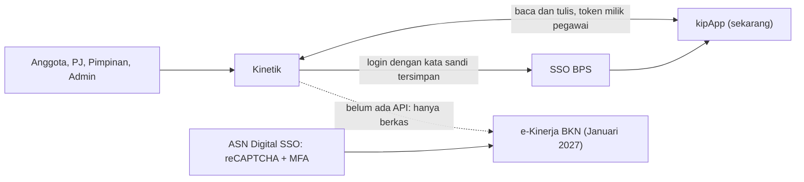

# Arsitektur: siapa bicara dengan siapa

Kinetik berada di tengah. Setelah Januari, yang berbicara dengan pegawai adalah e-Kinerja.

<!--
Ini gambaran konteks. Empat peran memakai Kinetik. Kinetik membaca dan menulis ke kipApp dengan token milik pegawai, yang didapat lewat login SSO BPS dengan kata sandi tersimpan. Mulai Januari 2027 pencatatan SKP pindah ke e-Kinerja BKN, yang dilindungi SSO ASN Digital dengan reCAPTCHA dan MFA. Belum ada API untuk Kinetik, jadi garis ke e-Kinerja putus-putus: hanya lewat berkas.
-->
