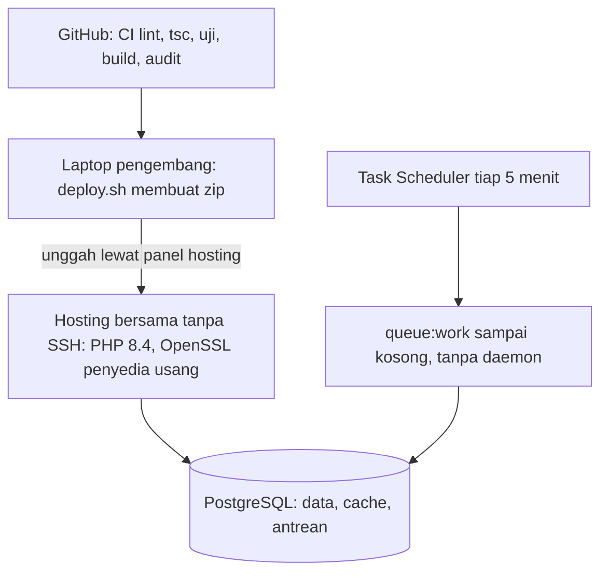

# Infrastruktur: hosting bersama yang membatasi desain

Tanpa SSH, tanpa proses latar permanen. Itu menentukan cara kerja semua pekerjaan terjadwal.

<!--
Aplikasi berjalan di hosting bersama tanpa SSH. Pembaruan dikirim sebagai zip lewat panel. Tidak ada worker yang menyala terus, jadi Task Scheduler menjalankan schedule:run tiap lima menit dan antrean dikerjakan sampai kosong. PostgreSQL menyimpan data, cache, dan antrean. OpenSSL penyedia sudah usang, jadi paket sertifikat dikirim bersama aplikasi. Bila integrasi BKN butuh pekerjaan panjang, hosting perlu dipikirkan ulang.
-->
