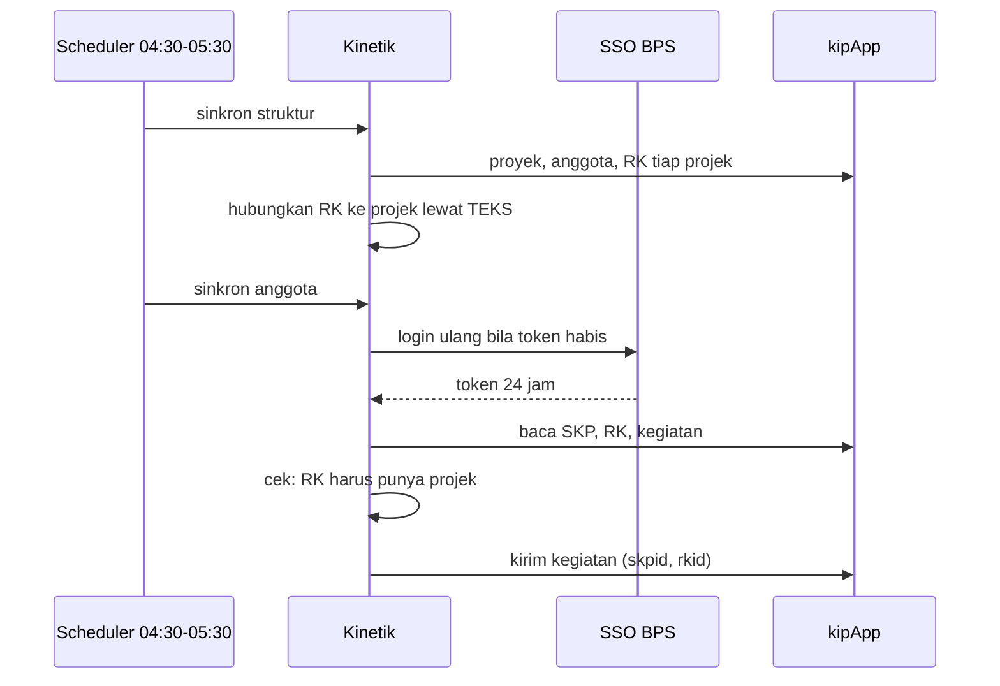

# Alur data: kipApp ke Kinetik dan kembali

Sinkronisasi harian membaca. Pegawai menyimpan kegiatan, lalu Kinetik menulis dengan token pegawai itu.

<!--
Tiap pagi antara 04.30 dan 05.30 WITA scheduler menarik struktur dan data anggota. Hubungan RK ke projek dibuat lewat teks karena tidak ada ID bersama. Bila token pegawai habis, Kinetik login ulang. Sebelum menulis ke kipApp, Kinetik memeriksa bahwa RK punya projek dan RK ada di SKP triwulan.
-->
