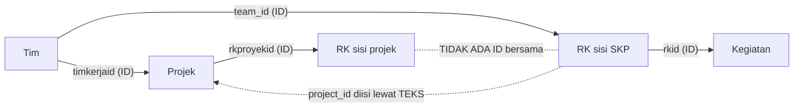

# Model data: di mana hubungan terputus

Tim, projek, dan kegiatan punya ID. RK sisi SKP dan RK sisi projek tidak.

<!--
Garis tebal adalah hubungan berdasarkan ID. Garis putus-putus adalah satu-satunya yang berdasarkan teks: RK di sisi SKP tidak membawa ID projek, dan RK di sisi projek memakai ID lain. Inilah sebabnya 1.006 RK tadinya tanpa projek. Setelah dihubungkan lewat teks, 537 terisi dan 469 sisanya memang tidak berada di projek mana pun atau ambigu.
-->
