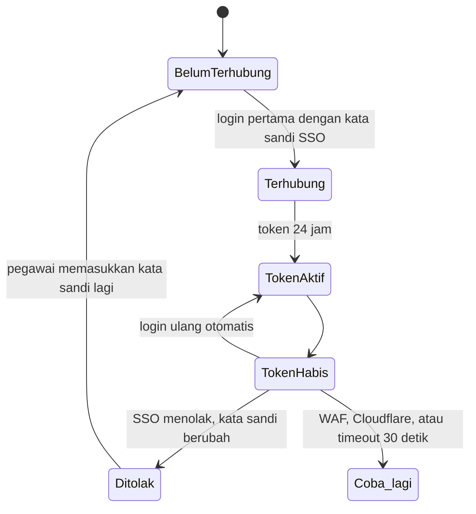

# Autentikasi: siklus hidup token

Setiap kegagalan di sini terlihat pegawai sebagai "tidak bisa login" atau "tidak bisa sinkron".

<!--
Pegawai memasukkan kata sandi SSO sekali, disimpan terenkripsi. Token kipApp berlaku sekitar 24 jam, lalu Kinetik login ulang diam-diam. Kegagalan yang kami temui: WAF memblokir User-Agent curl, Cloudflare menantang header JSON bawaan Laravel, dan timeout 15 detik terlalu pendek. Setelah Januari, pola ini tidak bisa ditiru untuk ASN Digital karena ada reCAPTCHA dan MFA di setiap login.
-->
