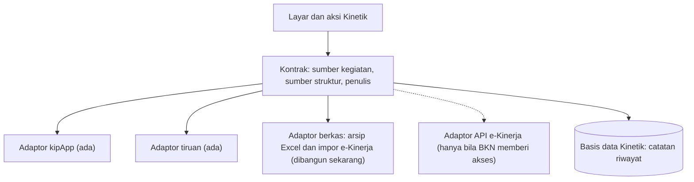

# Arsitektur target: tambah adaptor, bukan tulis ulang

Kontrak yang sudah ada memisahkan fitur dari sumber datanya.

<!--
Fitur Kinetik tidak berbicara langsung ke kipApp. Semuanya lewat kontrak: sumber kegiatan, sumber struktur, dan penulis, dengan implementasi kipApp dan tiruan. Migrasi berarti menambah adaptor. Adaptor berkas bisa dibangun sekarang: arsip Excel dan impor laporan e-Kinerja. Adaptor API e-Kinerja hanya mungkin bila BKN memberi akses resmi. Basis data Kinetik menjadi catatan riwayat yang tidak hilang bila kipApp dimatikan.
-->
