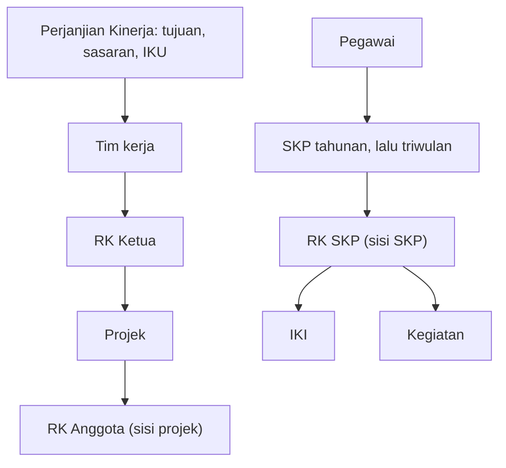
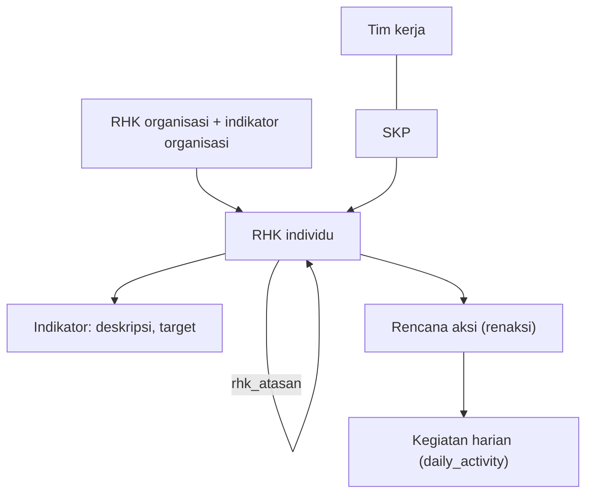

# Hierarki data: kipApp dan e-Kinerja

Dua pohon di kipApp, satu pohon RHK di e-Kinerja, dan tidak ada projek.

kipApp

e-Kinerja BKN

<b>Beda utama:</b> e-Kinerja tidak punya projek, dan RHK-nya saling terhubung ke RHK atasan lewat ID. kipApp memakai dua pohon RK (sisi projek dan sisi SKP) yang hanya cocok lewat teks.

<!--
Ini hierarki yang kami baca dari data kipApp dan dari kode e-Kinerja. Di kipApp ada Perjanjian Kinerja di atas, lalu tim kerja, RK Ketua, projek, dan RK Anggota. Di sisi pegawai ada SKP tahunan dan triwulan, RK SKP, IKI, dan kegiatan. Dua pohon RK itu hanya cocok lewat teks. Di e-Kinerja, RHK organisasi dan RHK individu saling terhubung lewat RHK atasan, ada tim kerja dan SKP, indikator dan rencana aksi di bawah RHK, lalu kegiatan harian. Tidak ada projek.
-->
